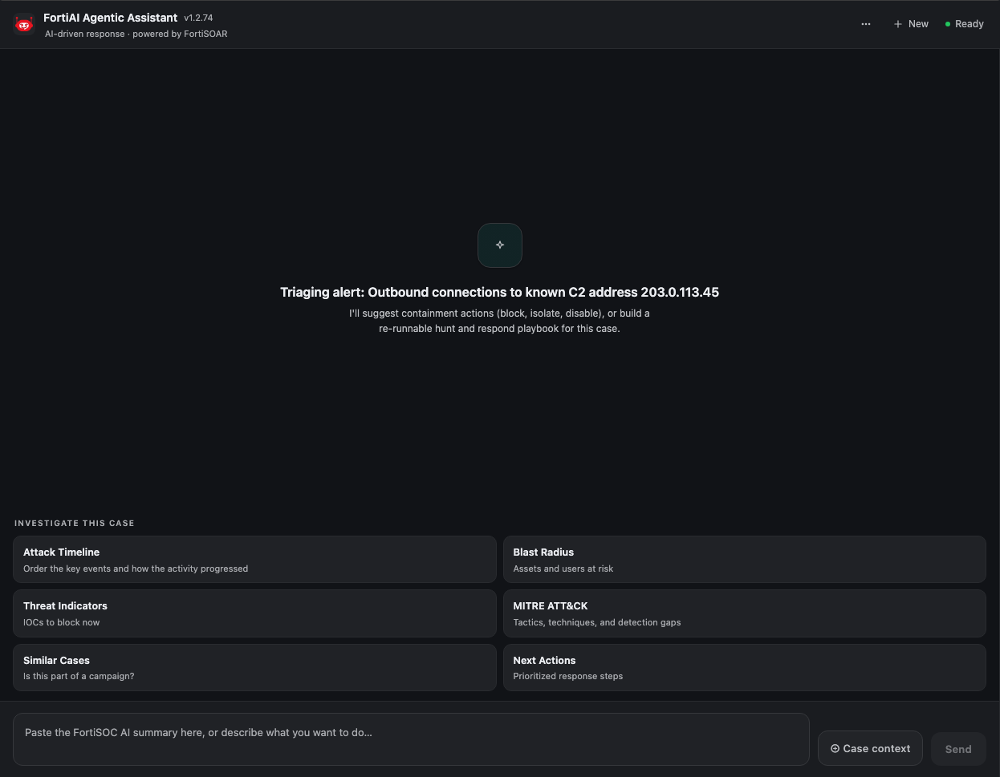
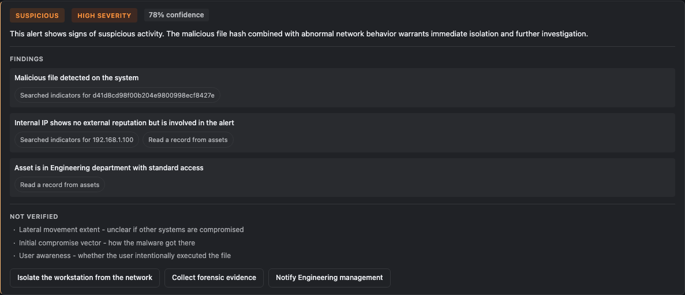
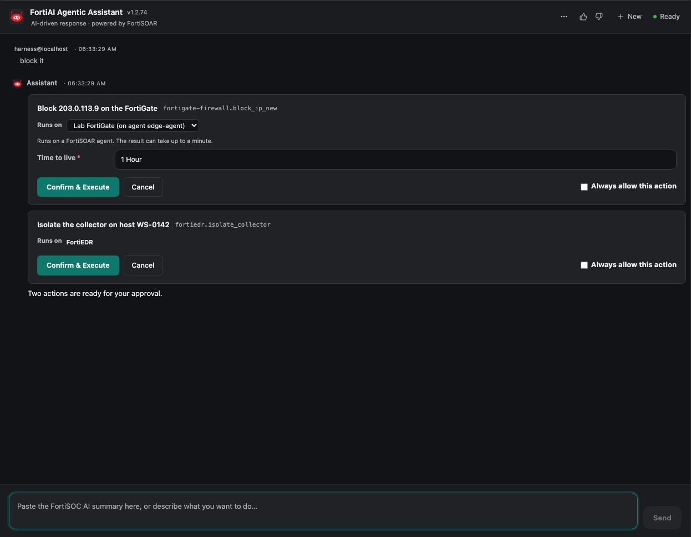
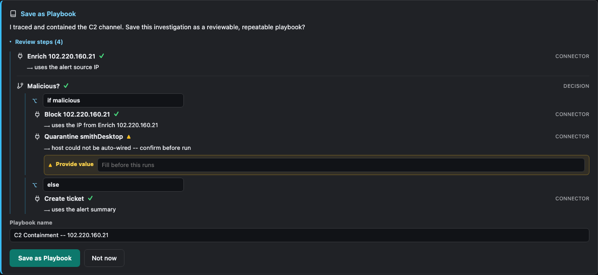
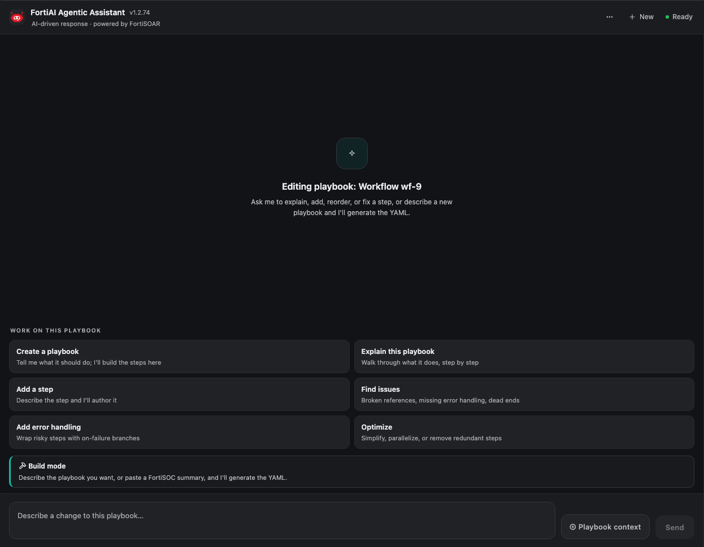
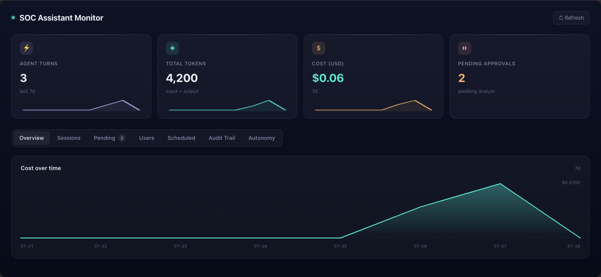
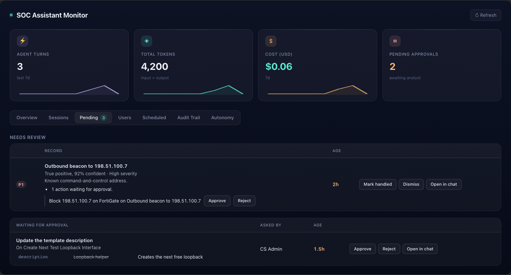
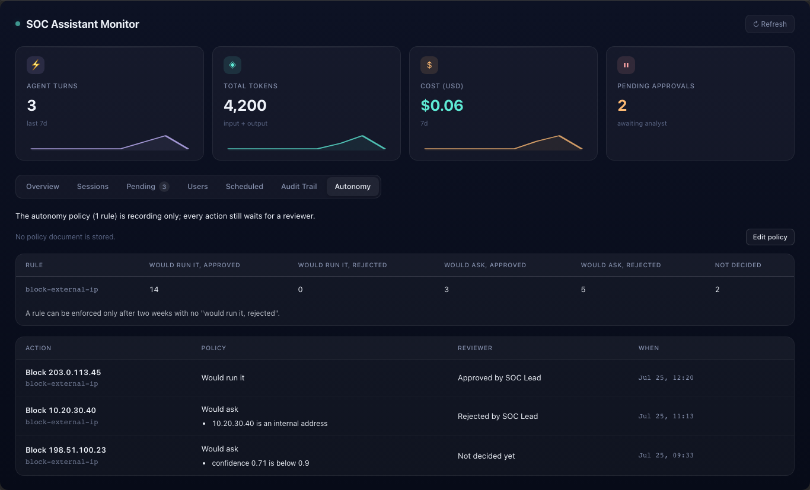

# Agentic Assistant -- User Guide

The Agentic Assistant is an AI analyst built into FortiSOAR. You talk to it in a
side panel next to the record or playbook you are working on. It reads the
record, queries your configured tools (firewalls, EDR, SIEM, threat intel), and
answers with evidence. Anything that changes something -- blocking an IP,
isolating a host, updating a record, saving a playbook -- waits for a person to
approve it.

This guide is for the people using it. Setup, configuration and how the
safety tiers work are in the [Setup & Operation Guide](AGENTIC_ASSISTANT_GUIDE.md).

There are three ways to use it:

| You want to... | Open it from | Section |
|---|---|---|
| Investigate an alert or incident | the record's detail page | [1](#1-investigating-an-alert) |
| Turn what you just did into a playbook | the same chat, at the end | [2](#2-turning-an-investigation-into-a-playbook) |
| Build, explain or fix a playbook | the playbook designer | [3](#3-building-and-fixing-playbooks) |
| Let it triage new alerts on its own, and review what it found | the Agentic Assistant Monitor | [4](#4-the-agentic-soc-auto-triage-and-the-review-queue) |

---

## 1. Investigating an alert

### Open it

Open an alert (or incident) and click the assistant icon to open the side
panel. The assistant already has the record in view: you do not need to paste
fields, IDs or indicators into the chat.

You can also open it from a module list (for questions across records, like
"which open alerts mention this host?"). It is not available on dashboards.

### Start with a one-click question, or just ask

Before your first message, the panel shows quick starts for the record:



| Button | What you get |
|---|---|
| **Attack Timeline** | The key events in order, and how the activity progressed |
| **Blast Radius** | Assets, users and systems affected or at risk |
| **Threat Indicators** | IPs, domains, hashes and URLs worth blocking now |
| **MITRE ATT&CK** | Likely tactics and techniques, and detection gaps |
| **Similar Cases** | Related records, and whether this looks like a campaign |
| **Next Actions** | Prioritized response steps for the record's severity and phase |

Or type a question in your own words: "Is this IP malicious?", "What else has
this user logged into today?", "Triage this alert".

### Read the verdict

A triage ends with a **verdict card**: the disposition (true positive, false
positive, benign, needs more information), a severity, a confidence, and the
findings behind it. Each finding cites the lookup it came from, so you can
check the evidence rather than take the conclusion on trust. If a source it
needed is not configured (say, no SIEM), it says so instead of guessing.
**Not verified** lists what it could not establish, and the buttons at the
bottom are suggested next steps you can send with one click.



### Approve, or cancel, an action

When the assistant recommends containment it does not run it. It shows an
**action card** that says what it will do, with which tool, and to what target.



- **Runs on** names the connector configuration the action will use, for
  example the firewall it will block on. If you have more than one (a lab and a
  production firewall, or a firewall reached through an on-prem agent), pick
  the right one from the list before you approve. The model may suggest one; you
  have the final say.
- Check or change the parameters (for example, how long a block lasts).
- **Confirm & Execute** runs the action and shows the result in the chat.
- **Cancel** drops it. The assistant continues without it.
- **Always allow this action** (tick it before confirming) lets later calls to
  the same action in *this chat* run without asking again. It does not carry
  over to other chats.

Each card is decided once. If someone else already decided it, for example a
lead in the Monitor queue, the card tells you who and what they decided.

If your admin has set **reviewer roles**, you can always decide the actions in
your own chat. Deciding someone else's needs one of those roles (see
[4.3](#43-who-can-decide)).

### Tips

- Ask follow-ups in the same chat. It remembers the record and what it has
  already looked up.
- **Case context** (next to the message box) pulls the record's details into
  the conversation again, for example after the record has changed.
- Chats are saved. Reopen one from the history list to pick up where you left
  off, including any action still waiting for a decision.

---

## 2. Turning an investigation into a playbook

When the assistant has run real actions for you -- lookups, enrichments, an
approved block -- it can offer to **Save as Playbook**. The offer lists the
steps it will build, in order, from what actually ran in this chat (not from
what the model said it did). Click **Review steps** to see each step, how it
is wired to the previous one, and any decision branches. A step marked
**Provide value** needs an input the assistant could not work out; fill it in.
Name the playbook, then click **Save as Playbook** to create it in FortiSOAR,
or **Not now**.



This is the point of the assistant: an investigation you did once becomes a
playbook that runs the same way every time, with no AI in the loop.

The new playbook is a normal FortiSOAR playbook. Open it in the designer to
rename it, change its trigger, or edit steps -- including with the assistant
(next section).

---

## 3. Building and fixing playbooks

Open a playbook in the **playbook designer** and open the assistant panel. It
already has the open playbook in view (**Playbook context** pulls in its
current steps again after you edit it by hand).



| Button | What it does |
|---|---|
| **Create a playbook** | Tell it what the playbook should do; it builds the steps into the open (usually empty) playbook |
| **Explain this playbook** | Walks through what each step does |
| **Add a step** | Describe the step; it authors it with the right connector, operation and parameters |
| **Find issues** | Broken references, missing error handling, dead ends |
| **Add error handling** | Wraps risky steps with on-failure branches |
| **Optimize** | Simplifies, parallelizes or removes redundant steps |

You can also ask in your own words: "Why did the last run fail?", "Add a step
that emails the SOC when severity is critical".

Nothing is written to the playbook until you click **Apply change** (or
**Apply fixes** after Find issues). Before offering a change, the assistant
checks it: references resolve, connectors and operations exist, and steps it
did not mean to touch are left alone. It will not offer an edit that deletes
steps you did not ask it to remove.

---

## 4. The agentic SOC: auto-triage and the review queue

The assistant can also work without anyone at the keyboard: it triages new
alerts as they arrive and hands people only what needs a decision. You review
that work in the **Agentic Assistant Monitor** widget, usually added to a SOC
lead's dashboard.

### 4.1 What runs on its own

- **Auto-triage.** When an admin turns it on for a module (alerts by default),
  every new record is triaged once, unattended, and ends with a verdict. When
  the agent wants to take an action, or the verdict needs a person, it
  **escalates** to the queue with the investigation already done.
- **Scheduled tasks.** Recurring questions ("summarize overnight critical
  alerts every morning") run on a schedule and show up in the Monitor.

Unattended runs follow the same rule as your chat: a state-changing action
waits for approval.

### 4.2 The Monitor

| Tab | What it shows |
|---|---|
| **Overview** | Activity and cost at a glance |
| **Sessions** | Every chat and unattended run; click one for the full timeline |
| **Pending** | Actions waiting for approval, and escalations waiting for a reviewer |
| **Users** | Who is using the assistant, and how much |
| **Scheduled** | Scheduled tasks, their last run and next run |
| **Audit Trail** | Every model call and tool call, for review and compliance |
| **Autonomy** | How the autonomy policy would have decided, next to what people decided (see 4.4) |



**Working the Pending tab:**



- For an action: **Approve** or **Reject** (the Monitor's names for the chat's
  Confirm & Execute and Cancel). **Open in chat** opens the conversation it
  came from, with the evidence.
- For an escalation: read the verdict and reasons, then **Mark handled** once
  you have dealt with it, or **Dismiss** if there is nothing to do. Actions in
  the same session stay in the queue until they are decided.

Each item is decided once. If a colleague got there first, you see who and what
they decided.

### 4.3 Who can decide

By default, anyone who can open the assistant can decide an action. An admin
can restrict that with **Reviewer Roles** on the connector configuration (a
comma-separated list of FortiSOAR role names). Once it is set:

- you can always decide the actions in **your own** chat;
- deciding **someone else's** action, or any action from auto-triage, needs one
  of the reviewer roles;
- closing an **escalation** always needs a reviewer role.

FortiSOAR itself tells the assistant who is clicking; the widget cannot claim
to be someone else. The name recorded against each decision is that verified
person. If the assistant cannot confirm who you are or what roles you hold,
the decision is refused and the item stays in the queue for a reviewer.

### 4.4 The Autonomy tab (shadow mode)

An admin can write an **autonomy policy**: narrow rules for actions that may
one day run without a click, for example "block an external IP when the
verdict is a true positive with confidence of at least 0.9, backed by a threat
intel lookup, at most 10 per hour".

Today the policy runs in **shadow mode only**: it never acts. On every action
card it records whether it *would* have run the action without asking, and
why or why not. The Autonomy tab puts those decisions next to what people
actually decided, per rule:

| Column | Meaning |
|---|---|
| Would run it, approved | The policy and the reviewer agreed it should run |
| Would run it, rejected | The policy would have run something a reviewer refused. **This must stay at zero** before a rule is trusted to act on its own |
| Would ask, approved / rejected | The policy held back (low confidence, internal target, rate limit, protected asset...) and left it to a person |
| Not decided | Nobody has decided the card yet |



Below the rules, a list shows each recent action: what the policy would have
done and why, what the reviewer decided, and when.

The policy has a kill switch (`enabled: false`), and an admin edits it in one
place (the `fsr_autonomy_policy` Key Store record). See the [Setup &
Operation Guide](AGENTIC_ASSISTANT_GUIDE.md#6a-autonomy-policy-shadow-mode).

---

## 5. What it will not do

- **Act without approval.** Every state change waits for a person (or, in the
  future, an admin-written policy rule that has passed its shadow period).
- **Invent results.** Findings cite the lookup they came from. If a source is
  not configured, it tells you instead of guessing.
- **Use tools your admin has not configured.** It discovers the connectors on
  your FortiSOAR; adding a connector configuration is how you give it a new
  capability.
- **Run for real in simulation mode.** If your admin turned on simulation mode,
  it describes the actions it would take and executes nothing.

## 6. When something goes wrong

| You see | What it means |
|---|---|
| "Only reviewers can decide this" | Reviewer roles are set and you do not hold one; ask a lead, or open the action from your own chat |
| "This card was already approved/rejected by ..." | Someone decided it first; nothing ran twice |
| A capability card saying a tool is not configured | The connector it needs is missing or down; ask your admin |
| The chat never answers | The connector's model configuration is missing or its key is invalid; ask your admin |

For setup and deeper troubleshooting, see the [Setup & Operation
Guide](AGENTIC_ASSISTANT_GUIDE.md#9-troubleshooting).

---

*Screenshots are generated from the widgets' mock fixtures, so they never show
a real appliance. To refresh them after a UI change (from the dev kit root):*

```
DOCS_SHOTS=1 make test-e2e-spec SPEC="widgets-src/agenticAssistant/tests/e2e/agenticAssistant.docsScreenshots.spec.js widgets-src/agenticAssistantMonitor/tests/e2e/agenticAssistantMonitor.docsScreenshots.spec.js"
```
